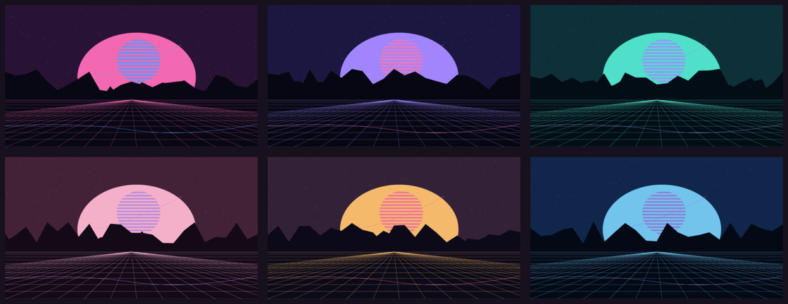
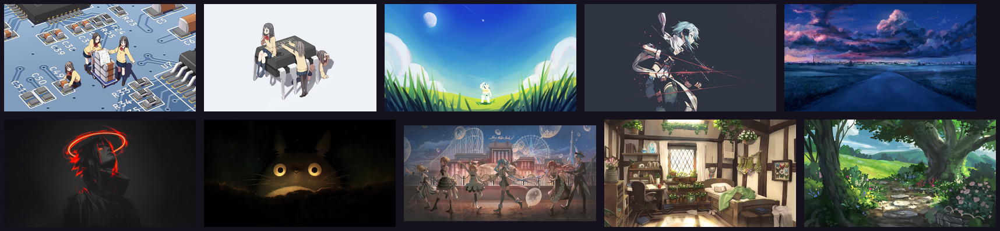

# Neon Studio

A personal Linux desktop setup with a native settings app, seven desktop widgets, live 1337 logtime, and six original **3840 × 2160 wallpapers** plus **ten anime wallpapers at 4K or higher**. Inspired by [TrpStrata](https://github.com/MliliGenes/TrpStrata).





## Install and run

Run these commands in a terminal inside your graphical desktop session:

```bash
git clone git@github.com:mar1-hh/faklosasd.git
cd faklosasd
bash install.sh
```

If you do not use SSH with GitHub:

```bash
git clone https://github.com/mar1-hh/faklosasd.git
cd faklosasd
bash install.sh
```

**No sudo is used.** The installer checks existing GTK libraries, chooses an existing Python interpreter with Requests, creates a user application launcher, starts the cards, and opens **Neon Studio**. It does not download system packages or edit your shell startup files.

After installation, search for **Neon Studio** in Applications, or run from the checkout:

```bash
bash open-studio.sh
```

Keep the checkout in place: the launcher points to it. If you move it, rerun `bash install.sh` from its new location. Close the older app/cards before switching from an earlier `~/Desktop/neon-desktop` installation to this checkout.

To install without starting anything:

```bash
bash install.sh --no-start
```

### Requirements

The main target is **Ubuntu 22.04, GNOME 42, X11**. The control panel uses GTK 4 and libadwaita; desktop cards run separately with GTK 3. Other GNOME releases may work but have not been visually verified. Wayland can restrict desktop positioning and dragging.

Required on the machine:

- `/usr/bin/python3` with PyGObject (`gi`), GTK 3, GTK 4, libadwaita 1 and GdkPixbuf/SVG support.
- A Python 3 interpreter with `requests` for logtime; it can differ from the GUI interpreter.
- GNOME's `gsettings`, user `systemctl`, and standard `pgrep` tools.
- An active GNOME Shell user service for personal-profile wallpaper changes.

The campus workstation used for development already had the GTK prerequisites. The installer reports missing libraries instead of attempting a privileged installation.

If only Requests is missing, use a local virtual environment:

```bash
python3 -m venv .venv
.venv/bin/python -m pip install -r requirements.txt
NEON_LOGTIME_PYTHON="$PWD/.venv/bin/python" bash install.sh
```

## Use the app

- **Wallpapers:** browse all 16 included scenes, select an additional folder, or use **Add to collection…** to import one or several images. Imports are copied into `state/wallpapers/`, stay in the gallery even if the originals are moved, and remain Git-ignored. Duplicate content is reused; conflicting filenames are kept as separate numbered files. **Open image…** is available for a temporary preview without importing.
- **Appearance:** automatically match the applied wallpaper’s dominant meaningful hue, or choose a fixed Rose, Violet, Teal, Amber or Blue preset; change widget size (80–180%), opacity, screen margin, and clock seconds. Changes save automatically.
- **Widgets:** toggle Logtime, Quick links, Clock, System monitor, Calendar, Notes and App launcher independently. Enable **Arrange widgets**, drag a card by its title/empty area, then disable Arrange to put cards behind normal windows. Notes are editable here.
- **Logtime:** set your 1337 username and target, inspect the active period, or refresh the API reading.
- **Tools:** start/stop cards, view diagnostics, restore saved widget/background settings, and disable the personal wallpaper setup.

Closing the control panel leaves the desktop cards running. Browser and app launches are asynchronous so they do not block the live clock/logtime.

### Start at login

Enable **Widgets → Start cards when I log in**. Installation does not enable login startup automatically. Disable the same switch to stop future automatic launches.

### Use the appearance settings from this setup

`config.example.json` contains the shareable appearance choices from the original setup, with machine paths and account details removed. It is optional; a fresh install otherwise uses the app defaults.

Before first installation, or after stopping the cards:

```bash
mkdir -p state
cp config.example.json state/preferences.json
bash install.sh
```

Copying this file replaces your saved widget preferences. It includes the larger widget size, opacity, margin, clock-seconds choice and card visibility. The wallpaper folder and username resolve locally.

## Apply a wallpaper

1. Open **Wallpapers** in Neon Studio.
2. Select a scene or use **Open image…** / **Change folder…**.
3. Click the wallpaper thumbnail. It applies immediately; **Reapply selected** is only a fallback.
4. If the app says the image was saved but the profile is pending, **log out and back in once**. Later wallpaper changes should be immediate.

The one-time logout lets GNOME Shell load the personal dconf profile. The app never forcibly restarts Shell. A campus that permits the TrpStrata-style personal-profile setup is required for this mode.

The setup writes only user-owned configuration:

```text
~/.config/dconf/neon-studio-wallpaper.profile
~/.config/systemd/user/org.gnome.Shell@x11.service.d/90-neon-studio-wallpaper.conf
```

A Wayland session uses its corresponding Shell unit. The personal profile selects the user settings database rather than the usual campus database stack, which also affects which managed defaults/locks Shell reads. Use this mode only where that session configuration is permitted. Existing conflicting profile overrides are preserved and reported.

The first wallpaper change backs up the previous background. Failed writes roll back completed changes. **Tools → Restore previous wallpaper** restores the saved image. **Tools → Disable personal wallpaper setup**, followed by logout/login, returns Shell to its previous profile selection. The inactive profile file is retained until after the running session can stop using it.

## Logtime

The original tracker is bundled as `logtime-core.py`; no separate Desktop script is needed. Set the username under **Logtime** or leave it blank to detect your Linux username. The default goal is 120 hours.

- A period runs from the 28th through the following 27th.
- The display is **projected hours**: API period total plus the active session, counting in `HH:MM:SS`.
- API requests refresh every five minutes, outside the graphical event loop, with verified TLS and caching.
- If `who` detects no login, the helper checks graphical logind sessions, then uses the GNOME Shell process age as a labelled estimate.
- If no session can be found, only the API total is shown. Confirmed campus credit can differ from the live estimate.

To diagnose logtime from the checkout after installation:

```bash
./python logtime-widget.py
```

The original script's `LOGTIME_API_URL`, `LOGTIME_TIMEOUT`, `LOGTIME_TARGET_HOURS` and other environment options remain available. This feature requires access to the configured campus API.

## Stop, restart, and update

**Tools → Stop desktop cards** stops them without closing the app.

From the checkout:

```bash
/usr/bin/python3 -c 'from studio_backend import stop_widgets; print(stop_widgets())'
```

Reload updated widget code:

```bash
bash restart-widgets.sh
```

Update this checkout:

```bash
git pull --ff-only
```

Close Neon Studio and run `bash restart-widgets.sh` afterward. Your private runtime settings are ignored by Git and stay local.

## Restore or uninstall

Use the restore buttons in **Tools** for individual changes. To remove the app launcher, login entry and this project's Shell override, and stop the cards:

```bash
bash uninstall.sh
```

Close any open control-panel window first. If the personal profile was enabled, log out/in after removal. The checkout, wallpaper collection and local backups remain on disk. Only launchers and overrides owned by this setup are removed; conflicting/unrelated files are preserved.

## Troubleshooting

**The app does not appear:** run `bash open-studio.sh` in a normal desktop terminal to see the error. Read `state/studio.log` for installer-launched errors.

**No cards or a card disappears:** check **Tools → Diagnostics**, visibility switches and whether Arrange is enabled. Desktop cards normally sit behind other app windows. Read `state/widgets.log`.

**Cards overlap at startup:** this version recalculates positions after GTK finishes sizing them. If you have previously saved overlapping drag positions, use **Widgets → Reset card positions**. The chosen size is preserved.

**Wallpaper saved but unchanged:** complete the one-time logout/login. If it still fails, check **Tools → Diagnostics**. An active GNOME Shell user service is required; conflicting profile overrides are reported rather than overwritten.

**42 Intra does not open:** check your default browser and connection. Failed or timed-out launches display a message under Quick links; live widget updates continue.

**Logtime is unavailable:** verify your username, API access and interpreter. Run `./python logtime-widget.py` and check `state/logtime.log`.

## Development and files

```text
control-center.py      GTK 4/libadwaita settings app
desktop-widgets.py     GTK 3 desktop cards and live layout
dashboard.py           Shared card content
native_wallpaper.py    Personal-profile setup, verification and undo
logtime-widget.py      Adapter around the supplied tracker
preferences.py         Validated preferences and atomic saves
external_actions.py    Asynchronous website/application launching
wallpapers/            16 wallpapers, original SVG sources and anime source manifest
config.example.json    Portable example appearance settings
tests/                 Headless regression tests
state/                 Private imports, settings, API cache, logs and backups (Git-ignored)
```

Legacy `extension/` and `configure.py` are retained for compatibility with the original prototype. Normal installation uses the standalone cards, not a GNOME extension.

Run checks from the repository root:

```bash
GSETTINGS_BACKEND=memory /usr/bin/python3 -m unittest discover -s tests -v
bash -n install.sh restart-widgets.sh uninstall.sh open-studio.sh
```

These check preferences, restore snapshots, wallpaper transactions and profile setup, missing optional apps, asynchronous launch failures/timeouts, live counting, widget placement, launchers and autostart ownership. Actual desktop rendering, browser launch and campus API behavior need verification in a graphical session.

Code and original assets are MIT licensed. The downloaded anime artwork belongs to its respective creators; source URLs and actual dimensions are recorded in [wallpapers/SOURCES.json](wallpapers/SOURCES.json). See [LICENSE](LICENSE) and [THIRD_PARTY.md](THIRD_PARTY.md). No personal logs, API responses, saved wallpaper backups, account names, interpreter symlinks or absolute user paths are published.


### Wallpaper colors and centered cards

**Automatically match wallpaper** is enabled by default. Click a wallpaper to apply it and extract its strongest meaningful hue: near-black backgrounds and transparent pixels are ignored, and neighboring hues are grouped rather than averaging unrelated colors together. That hue colors card numbers, headings, borders, progress, buttons and a dark tinted surface. The accent is adjusted for legibility. The current hex value is shown in Appearance. Choosing a fixed preset disables automatic matching; the switch or Match widget accent button turns it back on. Widget text and calendar/app-launcher content are centered within their cards.

All ten added anime wallpapers were checked from their actual file headers: eight are 3840×2160, one is 3840×2400, and one is 4500×2247. None was upscaled. Three downloaded WebP files were decoded to lossless PNG at their original dimensions for compatibility with this workstation’s image loaders. The original six landscapes remain included.


### Monster, Mushoku Tensei, Naruto and Orb pack

The app now downloads one sourced wallpaper for each requested series in the background when it opens: **Monster (Johan Liebert)**, **Mushoku Tensei: Jobless Reincarnation**, **Naruto (Rasengan)**, and **Orb: On the Movements of the Earth (Rafal)**. Their original pages and advertised dimensions are listed in [wallpapers/ANIME_PACK.json](wallpapers/ANIME_PACK.json).

These four files are fetched into the private, Git-ignored `state/wallpapers/` collection on your own machine. They are not falsely represented as already bundled downloads. The app validates the returned image, decodes it, and verifies at least 3840×2160 before adding it. It does not upscale a smaller preview or save an HTML error as an image. Completed files are cached; unavailable sources have retry and source-page controls on the Wallpapers page. You can also run `/usr/bin/python3 anime_pack.py` from the checkout to download without opening the control panel.

The tool session used to prepare this update cannot directly download from those image hosts, so live download availability still needs checking in your desktop session. Ordinary app operations stay responsive while the pack downloads. No login details, cookies, privileged commands, or Wallpaper Engine installation are needed.

### One-click wallpaper selection and transparent calendar days

Clicking a gallery thumbnail now applies that exact image and its automatic accent. Rapid clicks are debounced so the last choice wins. Startup/gallery refreshes only preview an image and never replace your background on their own. Selected/applied tiles have distinct outlines; failures retain the existing wallpaper and show an explanation. The one-time personal-profile login requirement is unchanged.

The GTK calendar's day grid, header and selected-day background are transparent. The card surface remains, and selected dates use the current accent color rather than a filled rectangle. Restart the cards once to load the new styling.
